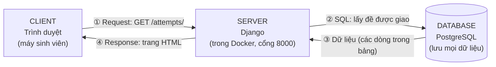
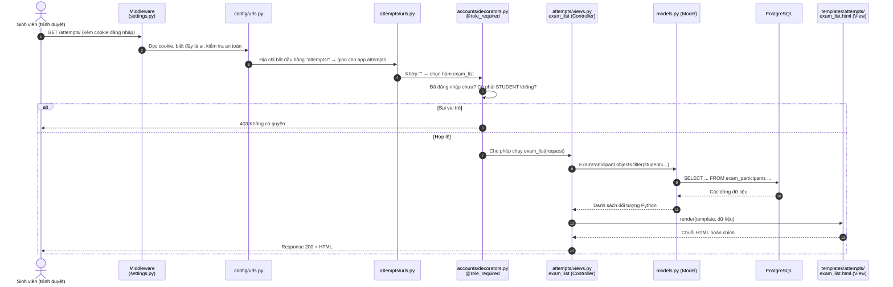
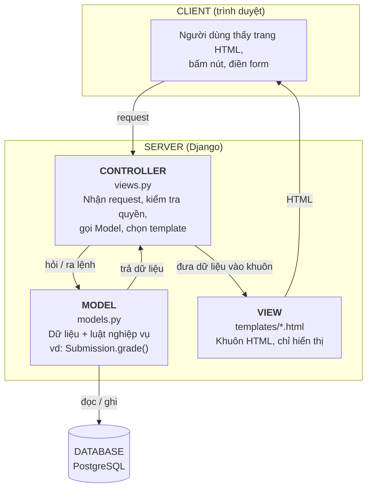
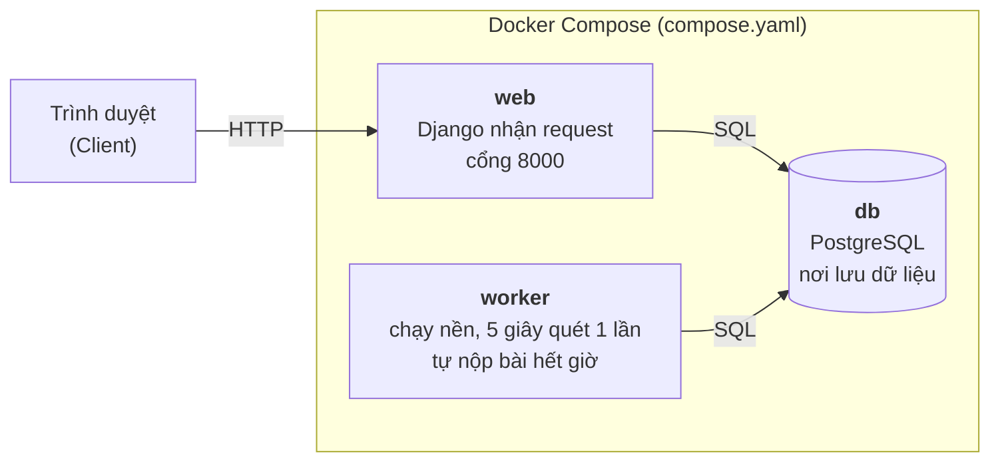
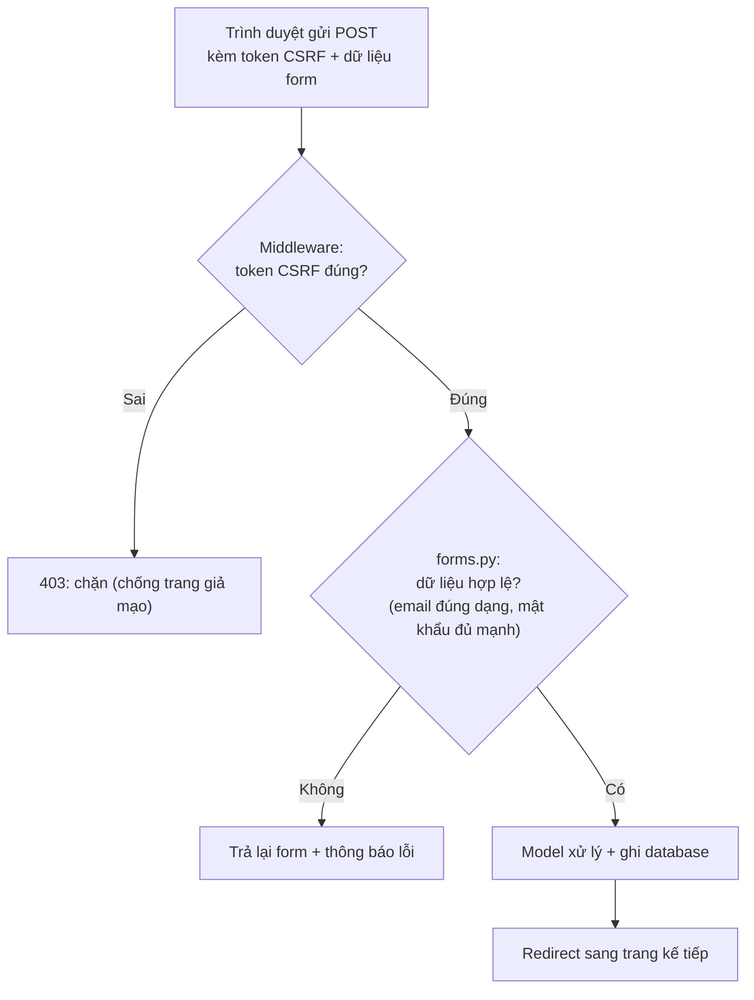
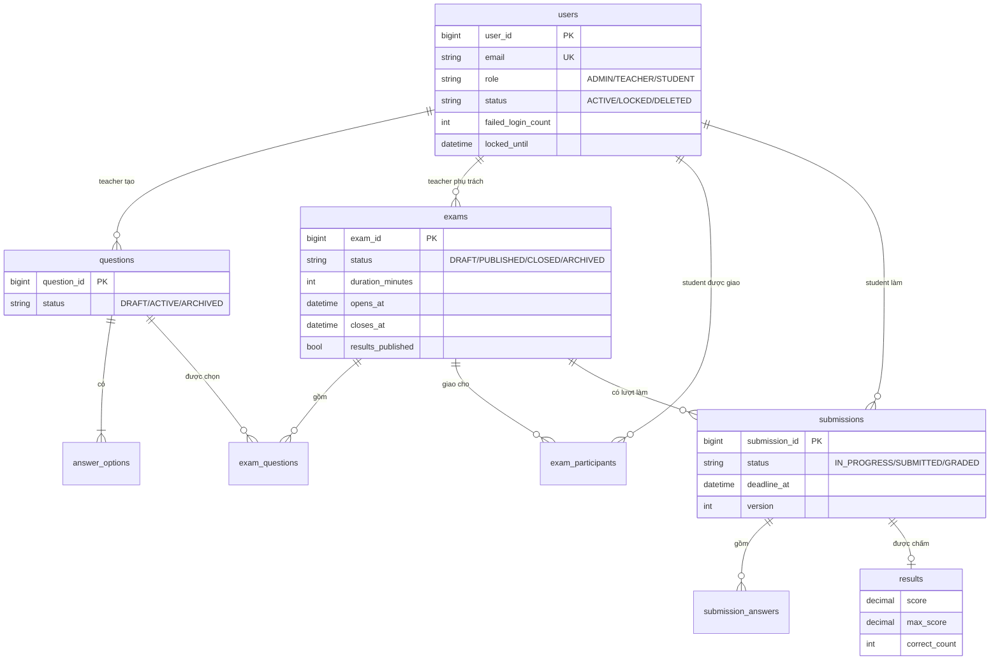
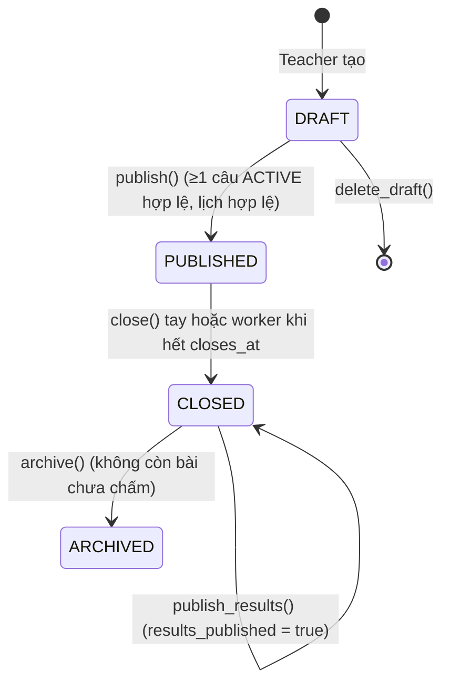
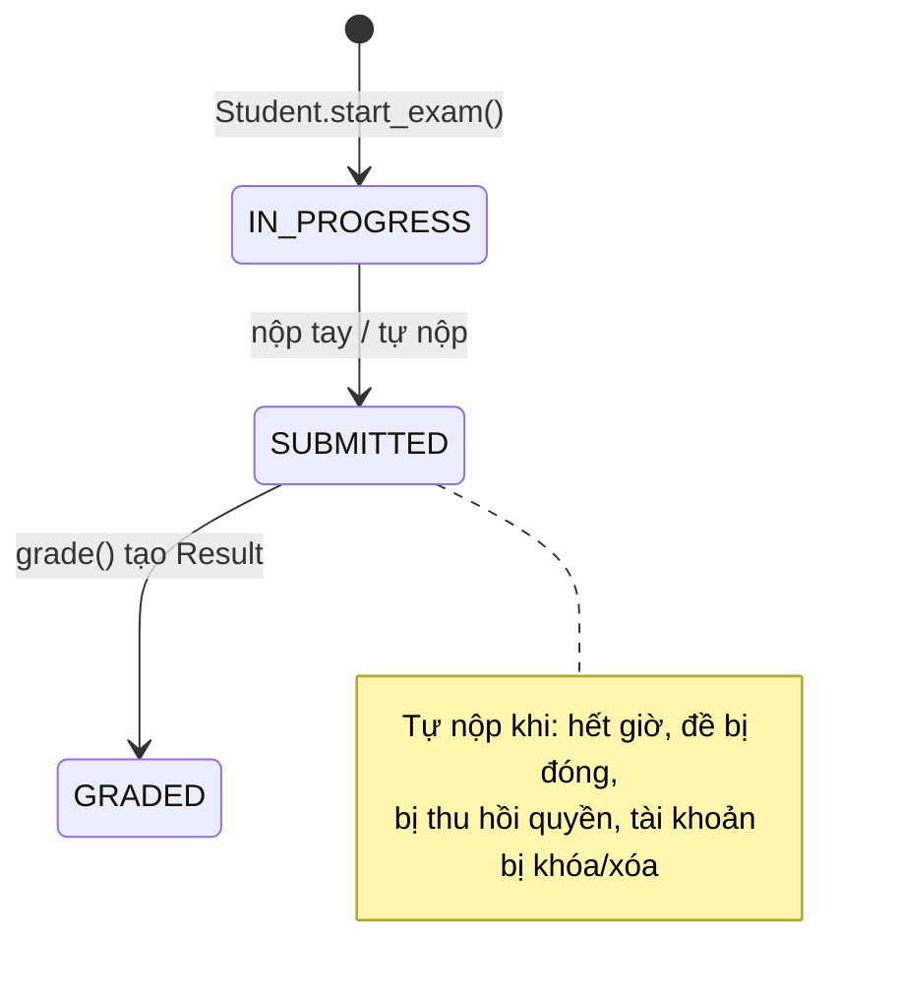
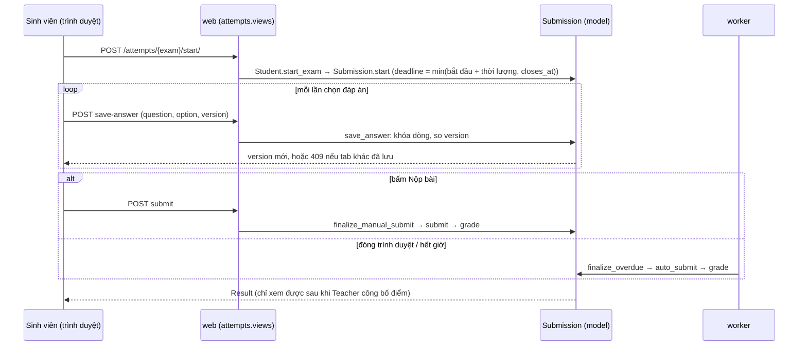

# Giải thích dự án để ôn vấn đáp

Tài liệu tra cứu kỹ thuật: mỗi thư mục/file làm gì, cơ sở dữ liệu, vòng đời đề thi và bài làm, các kỹ thuật đáng nói.
Mục 1 giải thích nền tảng cho người mới (client–server, MVC, một request đi qua file nào, Docker).
Luyện câu trả lời vấn đáp ở [07](07-on-van-dap.md).
Sơ đồ viết bằng Mermaid (GitHub, VS Code có cài "Markdown Preview Mermaid Support" đều hiển thị được).

## 1. Nền tảng: client–server, MVC, request

Dành cho người chưa làm web. Ví dụ nhà hàng và câu trả lời ngắn nằm ở [07](07-on-van-dap.md).

### 1.1 Client và Server nói chuyện bằng gì

Hai bên nói chuyện bằng **HTTP**: client gửi **request** (yêu cầu), server trả **response** (phản hồi). Mỗi request có một **địa chỉ (URL)** và một **phương thức**:

| Phương thức | Ý nghĩa | Ví dụ trong dự án |
| --- | --- | --- |
| `GET` | "Cho tôi xem" | Mở danh sách đề thi |
| `POST` | "Tôi gửi dữ liệu, hãy xử lý" | Bấm Đăng nhập, bấm Nộp bài |



Server trả về hai kiểu nội dung:

- **HTML**: cả một trang để trình duyệt vẽ lên (đa số trang).
- **JSON**: chỉ dữ liệu thô, không có giao diện. Dự án dùng JSON ở đúng một chỗ: tự lưu đáp án khi sinh viên chọn (mục 6).

### 1.2 Một request đi qua những file nào

Ví dụ sinh viên bấm vào menu "Đề thi của tôi", trình duyệt gửi `GET /attempts/`. Đây là hành trình trong code:



Đọc sơ đồ này, bạn nhớ được thứ tự: **URL → quyền → views.py → models.py → database → template → HTML trả về**.

### 1.3 Kiến trúc MVC trong dự án

MVC chia chương trình làm 3 phần, mỗi phần một việc, để sửa phần này không làm hỏng phần kia.



| Phần | Việc của nó | File trong dự án | Không được làm |
| --- | --- | --- | --- |
| **Model** | Mô tả bảng dữ liệu và luật nghiệp vụ ("đề đã đóng thì không cho nộp") | `models.py` | Không biết gì về HTML hay request |
| **View** | Vẽ giao diện từ dữ liệu được đưa vào | `src/templates/**/*.html` | Không tính toán nghiệp vụ |
| **Controller** | Người điều phối: nhận request, kiểm tra quyền, gọi Model, chọn template | `views.py` | Không viết luật nghiệp vụ, chỉ gọi Model |

> **Chú ý dễ nhầm:** Django đặt tên khác truyền thống. Cái Django gọi là **"view"** (`views.py`) thực chất là **Controller**. Cái Django gọi là **"template"** (`.html`) mới là **View** của MVC. Django tự gọi kiến trúc của mình là **MTV** (Model – Template – View) nhưng ý nghĩa giống MVC.

Ví dụ cụ thể, nút **Nộp bài**: `views.py` chỉ nhận request rồi gọi `submission.submit()`. Việc "đổi trạng thái sang SUBMITTED, ghi thời điểm nộp, đưa vào hàng chờ chấm" nằm trong `attempts/models.py`. Vì vậy dù sau này nộp bài từ nút bấm, từ worker tự nộp hay từ nơi nào khác, luật vẫn chỉ viết **một lần**.

### 1.4 Cây thư mục và một app gồm những gì

```text
quiz-examination-system/
├── Dockerfile, compose.yaml      Hướng dẫn Docker dựng 3 "máy ảo": db, web, worker
├── requirements.txt              Danh sách thư viện Python cần cài
├── .env / .env.example           Mật khẩu, cấu hình (.env không đưa lên Git)
├── scripts/                      Công cụ phụ: sao lưu database, đo tải 500 sinh viên
├── docs/                         Tài liệu, sơ đồ, hướng dẫn (bạn đang đọc ở đây)
└── src/                          *** TOÀN BỘ MÃ NGUỒN WEBSITE ***
    ├── manage.py                 "Công tắc điều khiển": chạy server, migrate, test
    ├── config/                   Cấu hình trung tâm của cả website
    ├── accounts/                 Tài khoản, đăng nhập, phân quyền
    ├── questions/                Ngân hàng câu hỏi
    ├── exams/                    Đề thi
    ├── attempts/                 Làm bài thi
    ├── results/                  Kết quả, điểm, thống kê
    ├── templates/                Giao diện HTML (tầng View)
    └── static/                   File tĩnh: CSS (css/app.css)
```

Mỗi app có cùng bộ file, học một app là hiểu cả năm:

Mỗi app là một "phòng ban" lo một mảng chức năng, và **các app đều có cùng bộ file** nên học một app là hiểu cả năm:

| File / thư mục | Vai trò | Thuộc MVC |
| --- | --- | --- |
| `models.py` | Định nghĩa bảng và luật nghiệp vụ (`Submission`, `SubmissionAnswer`) | **Model** |
| `views.py` | Các hàm xử lý request (`exam_list`, `start_exam`, `take_exam`, `save_answer_api`, `submit_exam`) | **Controller** |
| `urls.py` | Bảng địa chỉ riêng của app: địa chỉ nào → hàm nào | Định tuyến |
| `services.py` | Hàm hỗ trợ cho logic dài, ví dụ "kiểm tra hết giờ chưa" | Model (phần mở rộng) |
| `forms.py` | Kiểm tra dữ liệu người dùng điền vào (có ở `accounts`, `exams`) | Controller (hỗ trợ) |
| `migrations/` | Lịch sử thay đổi cấu trúc bảng; `manage.py migrate` áp vào database | Hạ tầng dữ liệu |
| `tests/` | Test tự động kiểm tra code chạy đúng | Kiểm thử |
| `apps.py`, `__init__.py` | File khai báo app (hầu như không phải sửa) | Hạ tầng |

Riêng từng app:

| App | Phụ trách | File đáng chú ý |
| --- | --- | --- |
| `accounts` | Đăng ký, đăng nhập, đổi mật khẩu, Admin quản lý user | `decorators.py` (`@role_required` chặn sai vai trò); `management/commands/seed_demo.py` (tạo dữ liệu mẫu) |
| `questions` | Câu hỏi và đáp án, nhập từ Excel | `importer.py` (đọc file Excel) |
| `exams` | Tạo đề, giao đề cho sinh viên, phát hành, đóng đề | `models.py` chứa `Exam.publish()` |
| `attempts` | Sinh viên làm bài, lưu đáp án tự động, nộp bài | `worker.py` + `management/commands/run_worker.py`: tiến trình nền tự nộp bài hết giờ |
| `results` | Chấm điểm, xem điểm, thống kê cho giảng viên | `statistics.py` (tính điểm trung bình, phổ điểm) |

### 1.5 Docker: ba "máy" chạy cùng lúc



Sao cần `worker`? Nếu sinh viên đóng trình duyệt giữa giờ thi, sẽ không còn request nào gửi lên server, nên cần một tiến trình nền tự quét database để nộp bài đúng hạn. `web` thì chỉ hành động khi **có người gửi request**.

### 1.6 Một request gửi dữ liệu (form) thì khác gì

Với `POST` (ví dụ đăng nhập), có thêm 2 lớp bảo vệ:



`` bạn thấy trong các file `.html` chính là cái token này. Nó có nhiệm vụ chứng minh "request này đến từ trang của chúng ta chứ không phải từ trang lạ".

### 1.7 Cách tìm code khi muốn sửa một chức năng

Giả sử bạn cần sửa trang "Danh sách đề thi của sinh viên". Đi theo đường mà request đã đi:

| Bước | Hỏi | Mở file |
| --- | --- | --- |
| 1 | Trang này có địa chỉ gì? Nhìn thanh địa chỉ: `/attempts/` | |
| 2 | Địa chỉ này giao cho app nào? | `config/urls.py` → `attempts/` |
| 3 | Hàm nào xử lý? | `attempts/urls.py` → `exam_list` |
| 4 | Xem logic của hàm | `attempts/views.py` → `exam_list` |
| 5 | Giao diện nằm đâu? | `templates/attempts/exam_list.html` |
| 6 | Dữ liệu và luật nghiệp vụ? | `attempts/models.py`, `exams/models.py` |

Quy tắc chọn nơi sửa:

- Sửa chữ, bố cục, màu sắc → **templates** hoặc `static/css/app.css`.
- Sửa quyền, luồng điều hướng, thông báo → **views.py**.
- Sửa luật ("khi nào được nộp", "cách tính điểm") → **models.py**.
- Thêm cột vào bảng → sửa **models.py** rồi chạy `python manage.py makemigrations`.

### 1.8 Từ khóa cần nhớ

| Từ | Nghĩa ngắn |
| --- | --- |
| Client / Server | Bên xin dịch vụ (trình duyệt) / bên phục vụ (Django) |
| Request / Response | Yêu cầu gửi đi / phản hồi trả về |
| URL, route | Địa chỉ trang; bảng ánh xạ địa chỉ → hàm xử lý |
| GET / POST | Xin xem / gửi dữ liệu để xử lý |
| HTML / JSON | Trang giao diện / dữ liệu thô |
| Model, View, Controller | Dữ liệu + luật / giao diện / người điều phối |
| Template | Khuôn HTML có ô trống để điền dữ liệu |
| Migration | Lịch sử thay đổi cấu trúc bảng |
| Session, cookie | Cách server nhớ bạn đã đăng nhập |
| Middleware | Lớp kiểm tra chạy trước mọi request (đăng nhập, CSRF) |
| Decorator (`@role_required`) | Dòng đặt trên hàm để chặn người không đủ quyền |
| Worker | Tiến trình nền chạy không cần ai bấm nút |

### 1.9 Hai khái niệm riêng của dự án

- **Migration**: file Python mô tả thay đổi cấu trúc bảng; `manage.py migrate` áp vào database.
- **Proxy model**: `Admin`, `Teacher`, `Student` dùng chung bảng `users` với `User`, khác nhau ở cột `role` và các phương thức riêng.

## 2. Cấu trúc thư mục và tác dụng từng file

### 2.1 Thư mục gốc

| File | Tác dụng |
| --- | --- |
| `README.md` | Giới thiệu, Quick Start, mục lục tài liệu, cấu trúc thư mục |
| `Dockerfile` | Công thức dựng image: Python 3.12, cài `requirements.txt`, chép `src/`, chạy bằng user thường (không phải root), khi khởi động tự `migrate` rồi `runserver` |
| `compose.yaml` | Khai báo 3 service `db`, `web`, `worker`; `web` đợi `db` healthy, `worker` đợi `web` healthy (để migrate xong rồi mới chạy); dữ liệu DB lưu ở volume `postgres_data` nên tắt container không mất |
| `requirements.txt` | Thư viện: `Django`, `psycopg` (nối PostgreSQL), `python-dotenv` (đọc `.env`), `openpyxl` (đọc/ghi Excel), `sqlparse`, `asgiref` |
| `.env.example` / `.env` | Mẫu và file thật chứa mật khẩu DB, `SECRET_KEY`, `DEBUG`... `.env` không đưa lên Git (xem `.gitignore`) |
| `.dockerignore`, `.gitignore`, `.editorconfig` | Bỏ file không cần khi build Docker / khi commit; thống nhất định dạng soạn thảo |
| `.venv/` | Môi trường ảo Python trên máy (không phải mã dự án) |

### 2.2 `scripts/`

| File | Tác dụng |
| --- | --- |
| `backup_db.sh` | `pg_dump` database trong Docker ra `backups/quiz-<ngày giờ>.dump`, kiểm tra file đọc lại được, chỉ giữ 7 bản mới nhất (NFR-REL-04) |
| `restore_db.sh` | Phục hồi database từ file dump |
| `check_backup.sh` | Kiểm tra bản sao lưu phục hồi được trước kỳ thi |
| `build_testcases.py` | Gộp các file `docs/testcases/S3-xx.csv` thành một bảng test case |
| `update_toc.py` | Tự cập nhật mục lục trong file Markdown |

### 2.3 `docs/`

- `guides/01..05`: hướng dẫn cài đặt, quy trình Git, quy tắc code, kiểm thử, sao lưu. File này là `06`.
- `project/`: kế hoạch dự án, yêu cầu môn học, kịch bản demo, báo cáo kiểm tra database.
- `testcases/S3-xx.csv`: test case của từng task Jira (S3-02 … S3-36).
- `*.drawio`: sơ đồ Use Case, Class Diagram, Data Model. `*.docx`: tài liệu đặc tả. Thư mục Figma: bản thiết kế giao diện.

### 2.4 `src/config/` — cấu hình trung tâm

| File | Tác dụng |
| --- | --- |
| `settings.py` | Đọc `.env`; khai báo 5 app; kết nối PostgreSQL; `AUTH_USER_MODEL = accounts.User` (đăng nhập bằng email); luật mật khẩu (≥ 8 ký tự, có chữ và số); phiên lưu trong DB, hết hạn sau 30 phút không hoạt động; cookie `HttpOnly`, `SameSite`; múi giờ Việt Nam; cấu hình 3 logger `[AUDIT]` |
| `urls.py` | Bảng định tuyến gốc: `/`, `/health/`, `/admin/`, rồi `include` URL của 5 app |
| `views.py` | `health` (kiểm tra web + DB, dùng cho healthcheck Docker) và `home` (Trang chủ khác nhau theo vai trò) |
| `navigation.py` | *Context processor*: tạo menu bên trái theo vai trò, đưa vào mọi template |
| `wsgi.py`, `asgi.py` | Cổng để máy chủ web gọi vào Django |
| `tests/` | Test chung: trang chủ, health, layout, luồng tích hợp |

### 2.5 `src/accounts/` — tài khoản và phân quyền

| File | Tác dụng |
| --- | --- |
| `models.py` | `User` (bảng `users`) + 3 proxy `Admin`, `Teacher`, `Student`. Chứa `User.login()` (khóa tạm 15 phút sau 5 lần sai), `change_password()`, `Admin.create_user/update_user/lock_user/reset_password/delete_user`, `Teacher.create_exam/assign_students/view_results`, `Student.start_exam/save_answer/submit_exam/view_result` |
| `views.py` | Đăng nhập, đăng xuất, đăng ký (chỉ tạo Student), đổi mật khẩu, 8 trang quản lý tài khoản của Admin; chống *open redirect* ở tham số `next` |
| `decorators.py` | `@role_required(...)`: chưa đăng nhập → trang Login, sai vai trò → 403. Kiểm quyền **ở máy chủ**, không chỉ ẩn nút |
| `forms.py` | Form kiểm tra dữ liệu nhập (đăng ký, tạo/sửa user, đổi mật khẩu, reset mật khẩu) |
| `validators.py` | Luật riêng: mật khẩu phải có cả chữ và số |
| `services.py` | `revoke_user_sessions()`: hủy mọi phiên đăng nhập của một user (khi khóa, đổi/reset mật khẩu) |
| `urls.py` | URL `/accounts/...` |
| `management/commands/seed_demo.py` | Lệnh tạo 6 tài khoản và dữ liệu demo (chạy lại không bị trùng) |
| `management/commands/dev_login.py` | Tạo phiên đăng nhập tạm và in cookie `sessionid` để chạy thử giao diện; chỉ chạy khi `DEBUG=True` |
| `migrations/` | 0001 tạo bảng; 0002 thêm ràng buộc SQL + trigger tự cập nhật `updated_at`; 0003 khai báo 3 proxy model Admin/Teacher/Student |

### 2.6 `src/questions/` — ngân hàng câu hỏi

| File | Tác dụng |
| --- | --- |
| `models.py` | `Question` (DRAFT → ACTIVE → ARCHIVED), `AnswerOption`. Quy tắc: câu ACTIVE phải có nội dung, ≥ 2 phương án, đúng 1 đáp án đúng; câu đã nằm trong đề đã phát hành thì khóa, muốn sửa phải `create_revision()` (tạo bản sao nháp) |
| `views.py` | Danh sách, tạo, sửa, tạo phiên bản mới, xóa, lưu trữ, khôi phục, nhập Excel, tải file mẫu |
| `importer.py` | Đọc file `.xlsx` (tối đa 2 MB, 500 dòng), kiểm tra từng dòng, trả `ImportRow`; tạo file mẫu |
| `urls.py` | `/questions/...` |

### 2.7 `src/exams/` — đề thi

| File | Tác dụng |
| --- | --- |
| `models.py` | `Exam`, `ExamQuestion` (câu trong đề: vị trí + điểm), `ExamParticipant` (sinh viên được giao). Các phương thức: `publish`, `close`, `archive`, `publish_results`, `duplicate`, `add_question`, `cannot_start_reason`... |
| `forms.py` | `ExamForm`: tên, mô tả, thời lượng, giờ mở/đóng |
| `views.py` | CRUD đề, chọn câu hỏi, giao sinh viên, phát hành, đóng, công bố điểm, lưu trữ, xóa nháp, nhân bản, xem trước; ghi log `exams.audit` |
| `urls.py` | `/exams/...` |

### 2.8 `src/attempts/` — làm bài, nộp bài, chấm

| File | Tác dụng |
| --- | --- |
| `models.py` | `Submission` (lượt làm bài), `SubmissionAnswer` (đáp án chọn). `start`, `save_answer` (có `version` chống ghi đè), `submit`, `auto_submit`, `grade` |
| `services.py` | `sync_and_finalize_if_needed()` kiểm tra 4 điều kiện phải chốt bài ngay (đã nộp, hết giờ, đề bị đóng, bị thu hồi quyền); `finalize_manual_submit()` cho nút Nộp bài |
| `views.py` | Danh sách đề của sinh viên, bắt đầu, phòng thi, **API lưu đáp án (JSON)**, nộp bài |
| `worker.py` | Logic nền: `close_expired_exams`, `finalize_overdue`, `retry_grading`, gộp trong `process_once()` |
| `management/commands/run_worker.py` | Lệnh `manage.py run_worker`: lặp mỗi 5 giây gọi `process_once()`, dừng an toàn khi nhận Ctrl+C/SIGTERM |
| `urls.py` | `/attempts/...` |

### 2.9 `src/results/` — kết quả và thống kê

| File | Tác dụng |
| --- | --- |
| `models.py` | `Result`: `calculate()` (tính điểm), `can_view()` (Teacher xem đề của mình; Student chỉ xem bài mình **sau khi công bố điểm**), điểm quy đổi thang 10, đúng/sai/bỏ trống, thời gian làm |
| `statistics.py` | Thống kê một đề: trung bình, cao nhất, thấp nhất, tỷ lệ đạt (≥ 5), phân bố điểm theo 5 khoảng, tỷ lệ đúng từng câu |
| `views.py` | Danh sách và chi tiết kết quả cho Teacher, xuất CSV, lịch sử bài thi cho Student |
| `templatetags/results_extras.py` | Filter `duration` đổi `timedelta` thành "12 phút 30 giây" |
| `urls.py` | `/results/...` |

### 2.10 `src/templates/` và `src/static/`

- `base.html`: khung chung (menu trái theo vai trò, thông báo). Mọi trang kế thừa file này.
- `home.html`, `403.html`, `404.html`; `partials/` (thông báo, phân trang, lịch thi, nội dung lỗi) dùng lại nhiều nơi.
- Mỗi app một thư mục: `accounts/`, `questions/`, `exams/`, `attempts/` (`take_exam.html` có JS đếm ngược và tự lưu), `results/`.
- `static/css/app.css`: CSS chung.

### 2.11 `tests/` và các thư mục `tests/` trong từng app

Test tự động (`python manage.py test`) nằm cạnh từng app; `tests/unit|integration|system` ở gốc dành cho giai đoạn 4. Test case thủ công nằm ở `docs/testcases/`.

## 3. Cơ sở dữ liệu (ERD)



Điểm đáng nói: ngoài ràng buộc Django, dự án thêm **CHECK constraint, khóa ngoại nhiều cột và trigger bằng SQL** trong các migration `0002_db_rules.py`. Mục đích: dù ai ghi thẳng vào DB cũng không phá được quy tắc. Ví dụ `uq_submissions_participant` chỉ cho mỗi sinh viên **một lượt** mỗi đề.

## 4. Vòng đời quan trọng

### 4.1 Trạng thái đề thi



Đề đã phát hành thì **không sửa** nội dung, thứ tự, điểm (BR-14) để kết quả cũ luôn đúng.

### 4.2 Trạng thái lượt làm bài



### 4.3 Luồng làm bài và nộp bài



### 4.4 Chấm điểm (`Result.calculate`)

Với mỗi câu trong đề: nếu đáp án sinh viên chọn trùng đáp án đúng thì cộng `points` của câu đó trong đề; sai hoặc bỏ trống = 0. `score` là tổng điểm câu đúng, `max_score` là tổng điểm cả đề. Điểm thang 10 = `score × 10 / max_score`, chỉ để hiển thị.

## 5. Các kỹ thuật đáng nói với giảng viên

| Vấn đề | Cách dự án giải quyết | Ở đâu |
| --- | --- | --- |
| Bảo mật đăng nhập | Băm mật khẩu, khóa 15 phút sau 5 lần sai, phiên hết hạn 30 phút, đổi mã phiên sau login | `accounts/models.py`, `settings.py` |
| Phân quyền | Decorator kiểm tra vai trò ở server, trả 403 | `accounts/decorators.py` |
| Hai tab cùng làm bài | Cột `version` (khóa lạc quan): gửi version cũ → 409 | `Submission.save_answer` |
| Hai người cùng thao tác | `select_for_update()` khóa dòng trong transaction | nhiều model |
| Nộp trùng | `_finalize` kiểm tra trạng thái, gọi lại vẫn chỉ ghi nhận một lần (NFR-REL-03) | `Submission._finalize` |
| Chấm lỗi không mất bài | Bắt exception, giữ `SUBMITTED`, worker chấm lại | `_finalize`, `worker.retry_grading` |
| Hai worker chạy chung | `select_for_update(skip_locked=True)`: dòng đang bị giữ thì bỏ qua | `attempts/worker.py` |
| Xóa tài khoản | Xóa mềm (`status=DELETED`) để giữ lịch sử (BR-15) | `Admin.delete_user` |
| Không khóa Admin cuối cùng | `_check_not_last_admin` | `accounts/models.py` |
| Nhật ký thao tác | Logger `[AUDIT]`: login, nộp bài, đóng đề, đổi tài khoản; xem bằng `docker compose logs web` | `settings.py` |
| Giờ giấc | Lưu UTC, hiển thị Asia/Ho_Chi_Minh; hạn nộp tính theo giờ máy chủ, không tin giờ trình duyệt | `settings.py`, `Submission.start` |

Câu hỏi vấn đáp thường gặp và cách trả lời: xem [07](07-on-van-dap.md) và [van-dap-theo-thanh-vien.md](../project/van-dap-theo-thanh-vien.md). Cách chạy thử: [01-getting-started.md](01-getting-started.md).
